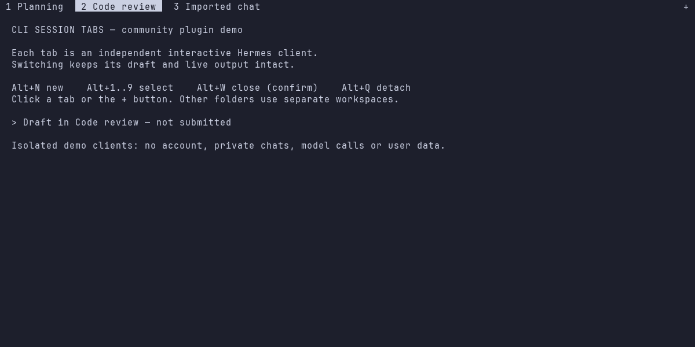

# CLI Session Tabs for Hermes

Directory-scoped chat tabs for Hermes. **v1.1.0** prefers native TUI tabs when the installed Hermes advertises the complete feature contract, and otherwise retains the isolated tmux backend.

The plugin never installs patches into Hermes. Native support is a separate [Hermes core contribution](https://github.com/cryptobredda/hermes-agent/tree/feat/native-tui-session-tabs-20261030); publishing this plugin does not mean that contribution has shipped in an upstream release.

## Install and diagnose

Requirements: Hermes **0.22.2+**, Python 3.10+, and an interactive POSIX terminal. Linux, macOS and Linux under WSL are supported. The fallback requires **tmux 3.2+**; native mode does not require tmux. Native Windows is not currently supported by this plugin.

The original v1.0.0 catalog entry was merged in [PR #145450](https://github.com/NousResearch/hermes-agent/pull/145450). Catalog installation follows the reviewed commit, which can lag the latest repository release while an update is under review.

```sh
hermes plugins install cli-session-tabs
hermes plugins enable cli-session-tabs
hermes tabs doctor --json
hermes tabs
```

To install directly from this repository rather than the catalog pin:

```sh
hermes plugins install https://github.com/cryptobredda/hermes-cli-tabs
```

Existing installations can use `hermes plugins update cli-session-tabs`; the available revision depends on their recorded install source and the reviewed catalog pin.

## Backend selection

```sh
hermes tabs                            # native when compatible; otherwise tmux
hermes tabs --directory ~/project      # exact canonical directory
hermes tabs --resume "chat title"       # preserve the exact resume argument
hermes tabs --backend native           # require native support; fail clearly if absent
hermes tabs --backend tmux             # explicitly select the original transport
hermes tabs --interface classic        # classic Hermes clients through tmux
hermes tabs doctor --json              # read-only backend/capability diagnostic
```

Native detection first checks `hermes --help` for the public `--tui-capabilities` flag. Only a CLI advertising it is probed. A schema-1 response must advertise `session_tabs`, `tab_commands`, `tab_persistence`, `background_activity`, and `slash_completion`, each at version 1 or later. An unknown, incomplete, failing or older response selects tmux in auto mode; the plugin never guesses support from a release number or reads private TUI files.

## Native mode

A single ordinary Hermes TUI owns the tab strip, session switching and draft persistence. This is the mode intended for Herdr and other host terminal multiplexers.

| Action | Command / control |
|---|---|
| New tab, leaving the current chat/task intact | `/new [title]`, `/tabnew`, Alt+N, or **+** |
| List this directory's opened tabs | `/tabs` or `/tab` |
| Select | `/tab 2`, `/tab <title or ID>`, click, or Alt+1–9 |
| Next / previous | `/tabnext`, `/next`, `/tabprev`, `/prev`, `/previous` |
| Close a view, never delete history | `/tabclose`, `/tab close`, Alt+W, or **×** |
| Keyboard cycling | Ctrl+PageUp / Ctrl+PageDown; Ctrl+Tab / Ctrl+Shift+Tab where reported by the terminal |

The compatible core provides:

- Exact canonical-directory scope, including symlink aliases, and profile-separated layout storage.
- Non-destructive `/new` and tab navigation while another tab is working: no prompt, queued correction or navigation message is sent to the old chat.
- Local-command suggestions merged with existing plugin/skill suggestions, with name matches ranked first and duplicate rows removed.
- Atomic private persistence of tab order, the selected stable session ID, and unsent multiline/paste/image-token drafts. Relaunching in the same profile and directory restores those views without replaying prompts or historical tools.
- Protected draft closing and a fresh blank view when the last tab is closed.
- Aggregate working/blocked/idle activity from opened tabs, including background tabs. In a fully identified Herdr pane, reports use its inherited pane identity rather than guessing which pane is focused.

Native control commands run **inside the TUI**. External `hermes tabs new/list/close/detach` operations are not a native remote-control API: the plugin tells you to use `/new`, `/tabs`, or `/tabclose` instead of reading or mutating private stores. Add `--backend tmux` to target an existing legacy workspace explicitly.

**Herdr restart boundary:** restoring a native layout after launching Hermes is not the same as Herdr automatically relaunching Hermes. Herdr 0.9.1 ignores the custom bridge's resume reference on a whole-Herdr restart; manually run `hermes tabs`/`hermes --tui` in the same directory in that case. The plugin does not update or restart Herdr.

## tmux compatibility mode



This screenshot uses clearly labelled synthetic clients, not private conversations. The original tmux backend remains available on unmodified supported Hermes releases.

```sh
hermes tabs --backend tmux
hermes tabs new --backend tmux
hermes tabs new --backend tmux --resume SESSION_ID
hermes tabs list --backend tmux --json
hermes tabs detach --backend tmux
hermes tabs close --backend tmux
```

| Action | Control |
|---|---|
| New tab | Alt+N or **+** |
| Select | Click or Alt+1–9 |
| Previous / next | Ctrl+PageUp / Ctrl+PageDown |
| Close | Alt+W or right-click, followed by visible confirmation |
| Detach, keeping clients and drafts alive | Alt+Q |

One isolated tmux server belongs to each profile/canonical-directory pair. Reattaching preserves the live clients; unrelated tmux servers and `.tmux.conf` are untouched. Closing a client explicitly can lose its unsent draft, so it requires confirmation. Detaching keeps it alive. The fallback does not serialize drafts across destruction of the tmux server, and does not gain native slash controls merely by updating this plugin.

Start this backend outside an existing tmux client. Explicitly combining the tmux backend with a native-capable TUI can produce nested tab strips; use auto/native mode for a single native strip, or `--interface classic` for transport-only tabs.

## Security and behavior disclosure

- Registration starts no child process. Only an explicit command probes the CLI, launches a TUI or manages an isolated tmux server. Start refuses non-TTY use; `doctor` does not launch a TUI or create plugin data.
- Child environments are allowlisted. Provider credentials, startup prompts, inherited resume handles, approval-bypass flags, and another client's gateway handles are not forwarded. Hermes loads credentials through its normal selected-profile routes.
- Native mode preserves only inherited terminal identity and a complete Herdr pane identity. tmux children do **not** inherit one shared Herdr identity.
- The plugin itself does not read or write conversation databases, transcripts, credential stores, private native-tab manifests, or native JavaScript bundles. It does not patch core or use undocumented tab stores.
- The compatible native core stores layout and unsent draft text privately under the selected profile's `ui-tui/session-tabs/` directory. Drafts are plaintext with mode 0600, not encrypted.
- The tmux backend stores workspace/executable paths and non-secret environment metadata under the profile's private `plugin-data/cli-session-tabs/` directory. Long socket roots use the protected per-user tmux directory under `TMPDIR`.
- No telemetry, automatic approvals, package downloads, runtime monkeypatches or background synchronization. The ordinary Hermes client retains its configured provider/network/MCP behavior.

## Development

```sh
python -m unittest discover -s tests -v
hermes plugins validate . --install-deps
```

Tests include real isolated tmux servers and attached terminal controls, literal quoted resume values, profile/directory isolation, a real fixture child for native launch, older-CLI fallback, strict capability negotiation, and credential/Herdr identity handling. Fixtures are explicitly synthetic; no test invokes a model. The MIT license is in `LICENSE`.
